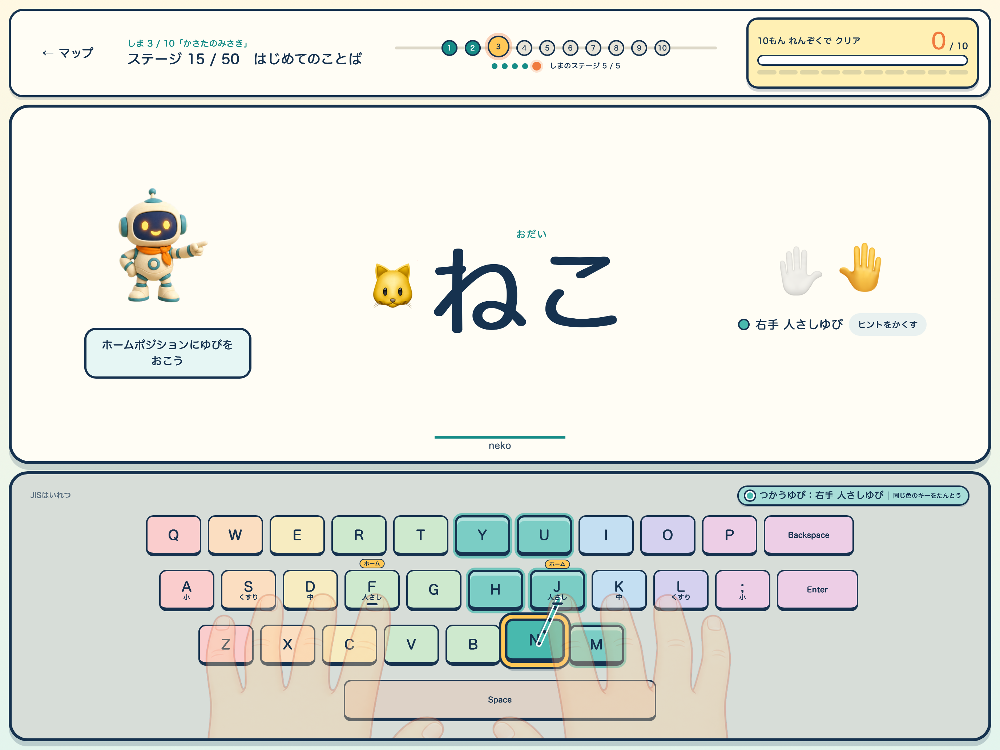
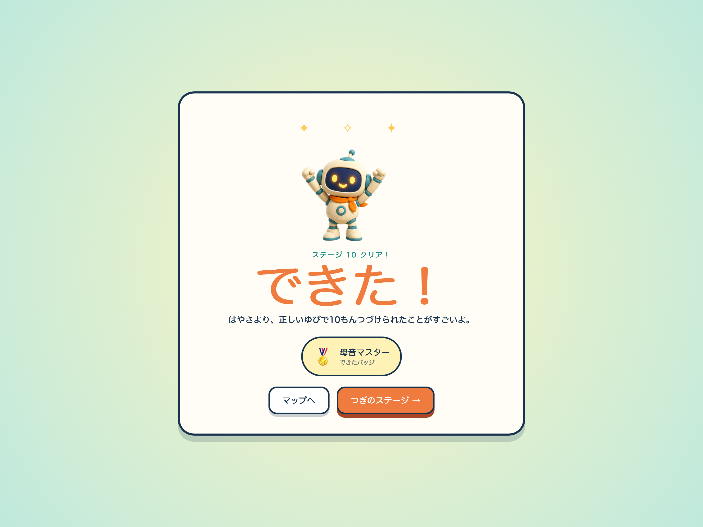

## キーボのタイピングじま

「キーボのタイピングじま」は、物理キーボードがはじめてのお子さんに向けたタイピング練習のWebアプリです。小学生を中心に、親子で安心して使えるように作りました。ブラウザで開けば、すぐに無料で始められます。

まずは速さよりも、「どのキーを、どの指で押すか」から。島をひとつずつめぐりながら、ホームポジション、ひらがな、ローマ字、日本語入力へと進みます。

間違えてもだいじょうぶ。押すキーと使う指をもう一度案内するので、あわてずにもう一度チャレンジしながら、小さな「できた！」を重ねていけます。

## 特徴

- ホームポジションから日本語入力まで、島をめぐりながら少しずつステップアップ
- 画面を見れば、押すキーと使う指がすぐにわかる
- お使いのキーボードに合わせて、JIS配列とUS配列から選べる
- `shi`と`si`など、よく使われる複数のローマ字入力に対応
- 速さやタイムは評価しない。正解で1ポイント、間違えると1ポイント減り、10ポイントで合格
- 最後は日本語入力に切り替えて、ひらがなの言葉をEnterで確定する練習まで
- 合格のバッジや、新しい島が開くことで、「できた！」を楽しく実感
- 1台の端末で最大5人まで、家族それぞれのプロフィールと進み具合をブラウザの中に保存
- 無料で、アカウント登録は不要
- 広告、ランキング、チャットはなし
- ホーム画面に追加すれば、アプリのように開けて、オフラインでも練習できる

## 必要なもの

- 外付けの物理キーボードをつないだiPad（横向き）、またはPC（Windows・Mac）
- 最新のブラウザ（Safari・Chrome・Edge）

iPadでは、Safariの共有メニューから「ホーム画面に追加」すると、アプリのように開けます。画面は見やすい横向き専用で、縦向きにしたときは横向きにするよう案内します。

## 練習画面

画面には、お題の文字、使う指、押すキーをまとめて表示します。「次はどこを押すの？」と迷いにくく、手元と画面を見比べながら自分のペースで練習できます。

## 「できた！」を積み重ねる

大切にしているのは、速さだけではありません。正しい指で最後まで取り組めたことを、ロボットのキーボといっしょにしっかりお祝いします。

<h2 id="privacy-policy">プライバシーポリシー</h2>

プライバシーポリシーと利用規約は、アプリのサイトに掲載しています。

- [プライバシーポリシー](https://keybo-typing-island.kand417.com/privacy)
- [利用規約](https://keybo-typing-island.kand417.com/terms)

<h2 id="support">サポート</h2>

使える環境や、データの保存と削除のしかたは、[おうちの人むけの説明](https://keybo-typing-island.kand417.com/specification)をご覧ください。

うまく動かないときや、その他のご質問は、[お問い合わせページ](/contact/)からお気軽にご連絡ください。
